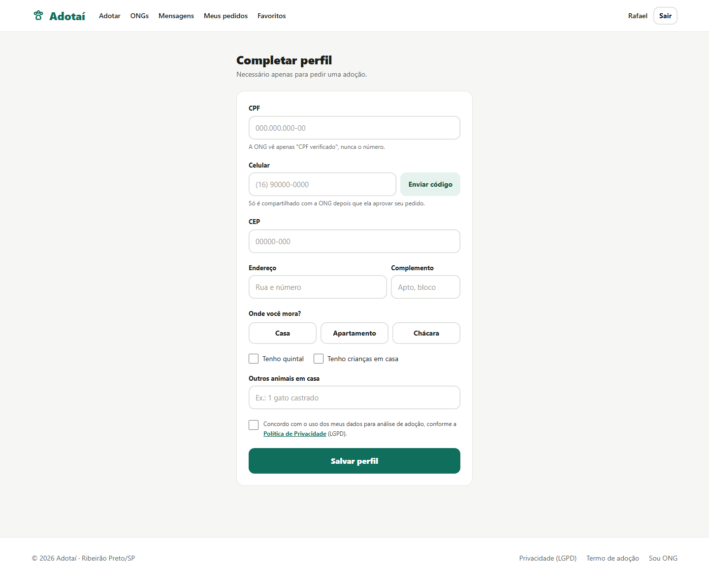
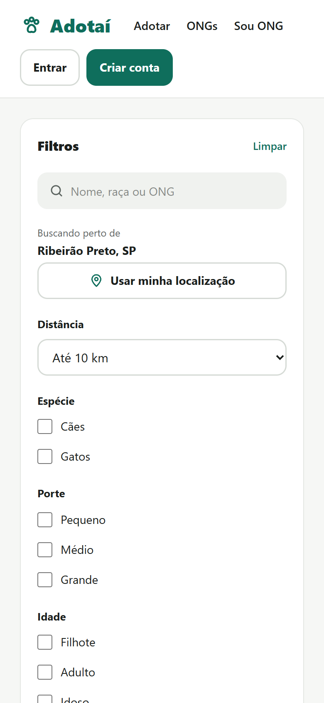
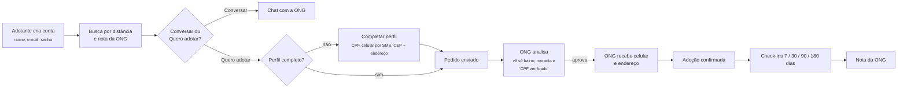
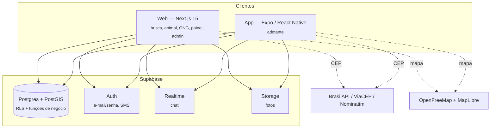

<div align="center">


# Adotaí

**Adoção de cães e gatos perto de você — com ONGs verificadas, chat e acompanhamento pós-adoção.**

Marketplace no estilo classificados: ONGs anunciam, adotantes buscam por distância e pela qualidade da ONG,
conversam pelo chat e a plataforma acompanha o animal depois da adoção.


</div>

<p align="center">
  
</p>

## Por que o Adotaí

Hoje a adoção acontece espalhada entre Instagram, grupos de WhatsApp e planilhas. Isso funciona para
divulgar, mas falha em duas coisas: **ajudar o adotante a escolher com calma** e **acompanhar o animal
depois que ele vai para casa** — que é onde acontecem as devoluções.

O Adotaí junta três coisas que hoje ficam separadas:

| | |
| --- | --- |
| 🔎 **Vitrine com busca por distância** | Lista + mapa + filtros (espécie, porte, idade, castração, convivência com crianças/cães/gatos, apartamento). |
| ⭐ **Reputação medida das ONGs** | Nota de 0 a 5 calculada com dados reais da plataforma, não só estrelas. |
| 🤝 **Pós-adoção estruturado** | Check-ins automáticos (7, 30, 90 e 180 dias), alerta para a ONG e botão "estou com dificuldade". |

## Telas

<table>
  <tr>
    <td width="50%"><br/><sub><b>Página do animal</b> — saúde, convivência, ONG com nota e tempo de resposta.</sub></td>
    <td width="50%"><br/><sub><b>Completar perfil</b> — CPF, celular por SMS e CEP que preenche cidade e bairro.</sub></td>
  </tr>
  <tr>
    <td><br/><sub><b>Painel da ONG</b> — indicadores, candidatos e alertas de pós-adoção.</sub></td>
    <td><br/><sub><b>Página pública da ONG</b> — nota, adoções, animais e chave Pix para doações.</sub></td>
  </tr>
  <tr>
    <td><br/><sub><b>Chat</b> — sempre ligado a um animal, em tempo real.</sub></td>
    <td><br/><sub><b>Pós-adoção</b> — check-ins de cada adoção e acompanhamento da ONG.</sub></td>
  </tr>
</table>

<p align="center">
  
  <br/><sub>Site responsivo no celular. O app nativo (Expo) está em desenvolvimento.</sub>
</p>

## Como funciona



### Regras de privacidade (LGPD)

- **Cadastro em duas etapas:** para olhar, favoritar e conversar basta nome, e-mail e senha. CPF, celular e endereço só são pedidos ao clicar em **"Quero adotar"**.
- **A ONG nunca vê o CPF** — apenas o selo "CPF verificado".
- **Celular e endereço completo** só são liberados para a ONG **depois que ela aprova** o pedido.
- Localização dos animais no mapa é **arredondada (~1 km)**; distâncias abaixo de 1 km aparecem como "menos de 1 km".
- Exclusão de conta a qualquer momento (com anonimização quando já houve adoção).

Essas regras ficam **no banco** (Row Level Security + funções SQL), não só na interface.

### Nota da ONG

| Critério | Peso | Como mede |
| --- | --- | --- |
| Sucesso das adoções | 30% | % sem devolução após 90 dias |
| Pós-adoção cumprido | 20% | % de check-ins respondidos |
| Avaliação de adotantes | 20% | Estrelas, só de quem adotou pelo app |
| Tempo de resposta | 15% | Mediana da 1ª resposta no chat |
| Transparência | 15% | Anúncios com saúde e descrição completas e atualizados |

ONGs com menos de 5 adoções aparecem como **"Nova na plataforma"**. A ordenação "Recomendado" combina 60% proximidade e 40% nota.

## Arquitetura



Tudo gratuito no início: mapas com **OpenFreeMap/OpenStreetMap** (sem chave), CEP com **BrasilAPI/ViaCEP**, backend no plano free do Supabase.

```
app-pet/
├── apps/
│   ├── web/          Next.js — site público, área do adotante, painel da ONG e admin
│   └── mobile/       Expo — app do adotante (em desenvolvimento)
├── packages/
│   └── shared/       Tipos do banco, validação de CPF/CNPJ, máscaras, CEP, rótulos pt-BR
├── supabase/
│   ├── migrations/   Schema, RLS, funções (busca por raio, pedidos, ranking), storage
│   └── seed.sql      Dados fictícios de Ribeirão Preto
└── scripts/          Gerador das capturas de tela
```

## Rodando localmente

Pré-requisitos: **Node 20+**, **Docker** (para o Supabase local).

```bash
npm install                 # instala web + shared + CLI do Supabase
npx supabase start          # sobe Postgres, Auth, Realtime e Storage no Docker (aplica migrations e seed)
npx supabase status -o env  # copie API_URL e ANON_KEY
cp apps/web/.env.example apps/web/.env.local   # e cole os valores
npm run dev:web             # http://localhost:3000
```

**Usuários de teste** (senha `adotai123`):

| E-mail | Papel |
| --- | --- |
| `adotante@adotai.dev` | Adotante com perfil completo |
| `novo@adotai.dev` | Adotante só com a etapa 1 (para testar "Completar perfil") |
| `ong1@adotai.dev` | Patas Unidas (verificada, nota 5,0) |
| `ong2@adotai.dev` / `ong3@adotai.dev` | Lar do Focinho / Abrigo Esperança |
| `admin@adotai.dev` | Administração |

No ambiente local o SMS é simulado: use o celular **(16) 99999-0000** e o código **123456**.

Outros comandos:

```bash
npm test                 # testes do pacote compartilhado (CPF, CNPJ, CEP, máscaras)
npm run lint:web
npm run build:web
npm run db:reset         # recria o banco local com migrations + seed
npm run db:types         # regenera os tipos TypeScript a partir do banco
node scripts/screenshots.mjs <id-de-um-animal>   # atualiza as imagens deste README
```

## Roadmap

- [x] Plano, protótipo e decisões de produto
- [x] Banco: schema, RLS, busca por raio, pedidos, chat, pós-adoção, ranking
- [x] Web: busca com mapa, animal, ONG, cadastro em 2 etapas, chat em tempo real, painel da ONG, admin
- [ ] App mobile (Expo) do adotante
- [ ] Projeto Supabase em produção + deploy da web
- [ ] SMS real (provedor de SMS) e e-mails transacionais
- [ ] Tarefas agendadas (check-ins atrasados, recálculo de notas) com `pg_cron`
- [ ] Fase 2: buscas salvas com alerta, avaliações na interface, carteira de saúde
- [ ] Fase 3: relatórios para ONGs, doações via Pix integradas, equipe com papéis

## Aviso

Todos os nomes de ONGs, animais e pessoas nos dados de exemplo e nas imagens são **fictícios**.
A Política de Privacidade e o Termo de Adoção incluídos são **rascunhos** e precisam de revisão jurídica antes do lançamento.
